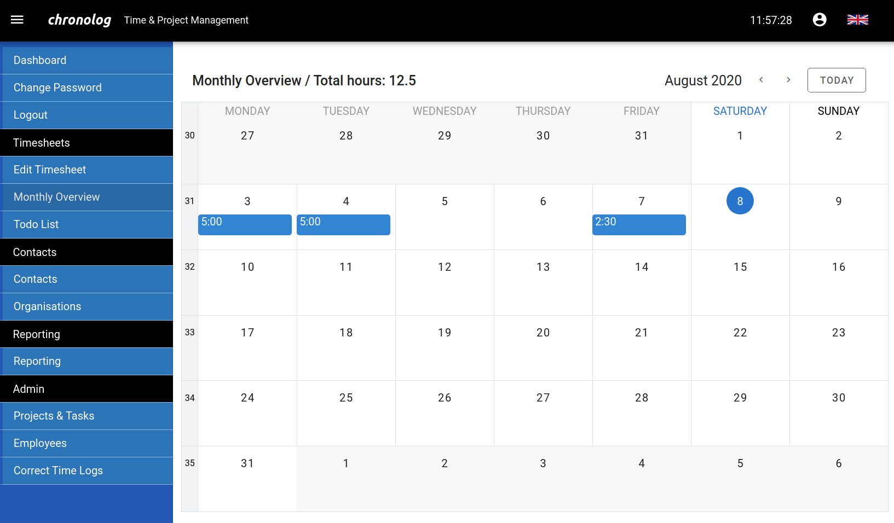

# chronolog Time Sheets

Time sheet application with TypeScript/Node.js backend and Vue/JavaScript frontend.



## Features

- Time sheet input
- Daily, weekly and monthly time sheet views
- Working time recording
- Todo lists
- Invoicing
- Printable reports
- Address administration (organisations and contacts)
- Multi-user and multi-customer

## Try out

Pull the docker image from GitHub (or Docker Hub) and follow the `Deploy` and `Run` instructions below.

```
$ docker pull ghcr.io/junglerider/chronolog/chronolog:1.1.0
  or
$ docker pull junglerider/chronolog:1.1.0
```

## Install (development)

Use Node.js 24 LTS and npm for installation. You also need sqlite3 for building a demo database. The API and web application are installed separately:

```
cd api
npm install

cd ../app
npm install
```

## Build (development)

The application runs in a single Docker container. It uses an SQLite database to persist information. To create a production build, run:

```
./build docker
```

This creates a new Docker image called `chronolog` which exposes internal port 5404 (or as configured in `api/src/config.json`). The image includes the single-admin `db/empty.db` demo database; it does not include or regenerate `db/chronolog.db`.

To regenerate the populated demo database in the repository, run `./build db --force` only when you intend to discard the existing `db/chronolog.db` and recreate it from the schema and fixtures. Without `--force`, `./build db` creates the database only when that path does not already exist. The Docker build does not run this command.

## Deploy

The database included in the image is for demos and testing; it will be destroyed along with the container. For production, place a backed-up `chronolog.db` database file in a directory of your choice and use a host mount, e.g.:

```
docker run -d --name chronolog -p 5404:5404 -v /your/db/directory:/home/db chronolog
```

This makes the application available at localhost:5404 and looks for the chronolog.db file in /your/db/directory. If you want to start with an empty database instead, copy `db/empty.db` into the mounted database directory and rename it to `chronolog.db`.

## Run

```
http://localhost:5404
```
The Chronolog web application at this URL should display a login dialogue. The image's `empty.db` database contains one user named `admin`. The password for this account is empty, so it can log in without a password; set a password immediately and do not expose a demo deployment publicly. The generated `db/chronolog.db` database contains four sample users (`enzo`, `james`, `gabriella`, and `mehmed`), also with empty passwords.